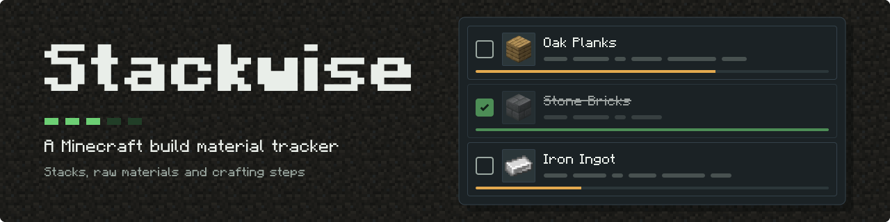
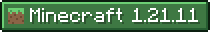
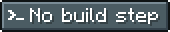
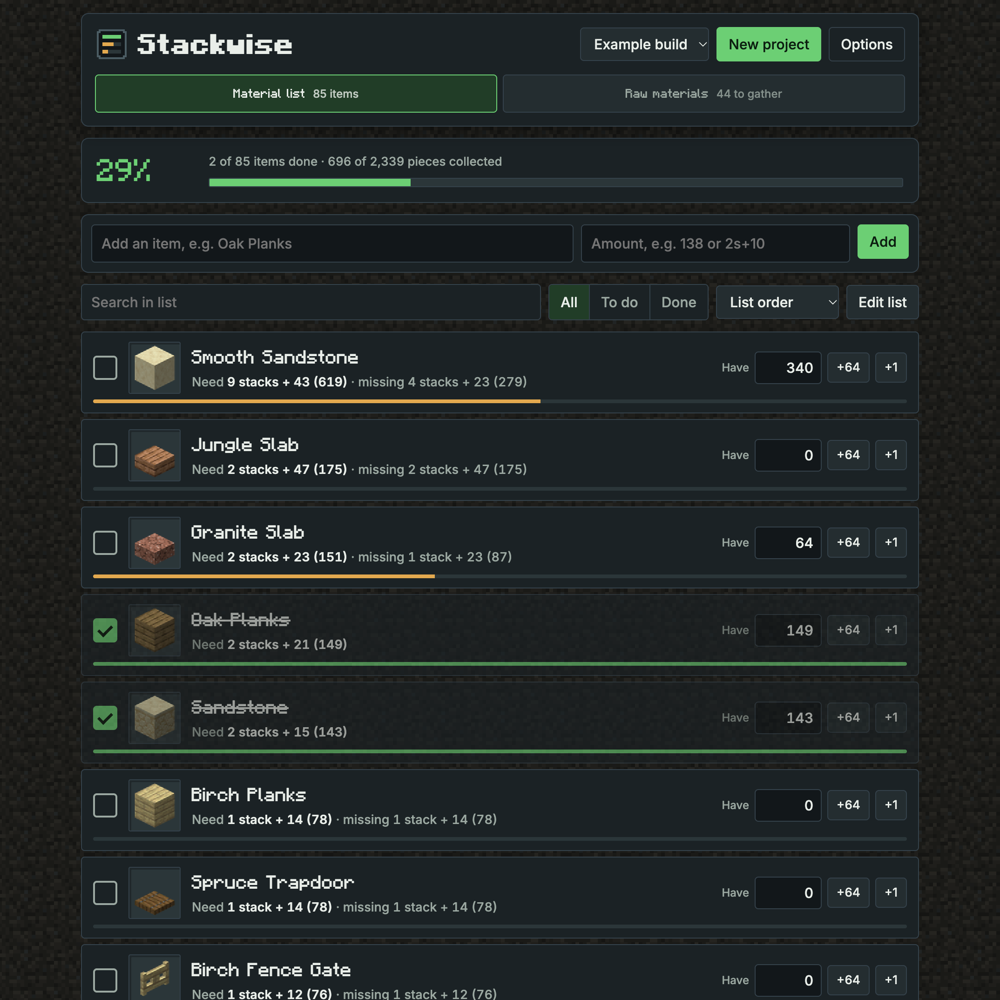
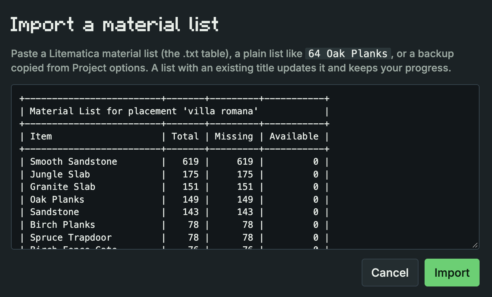
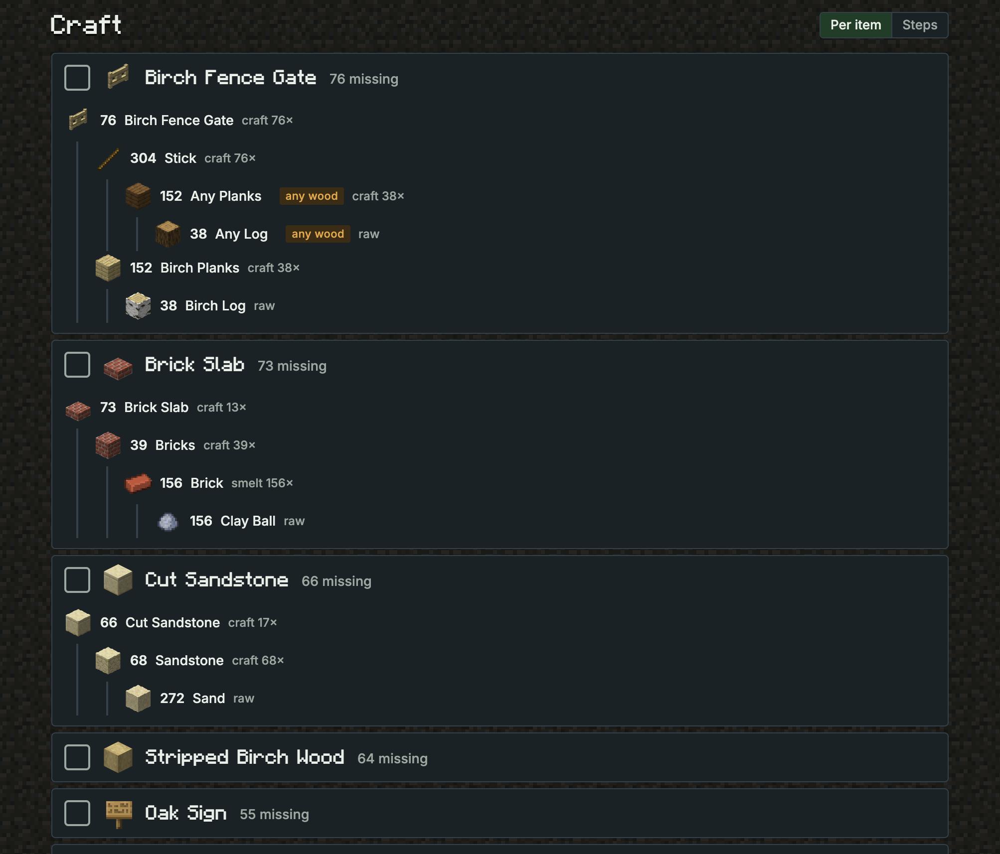
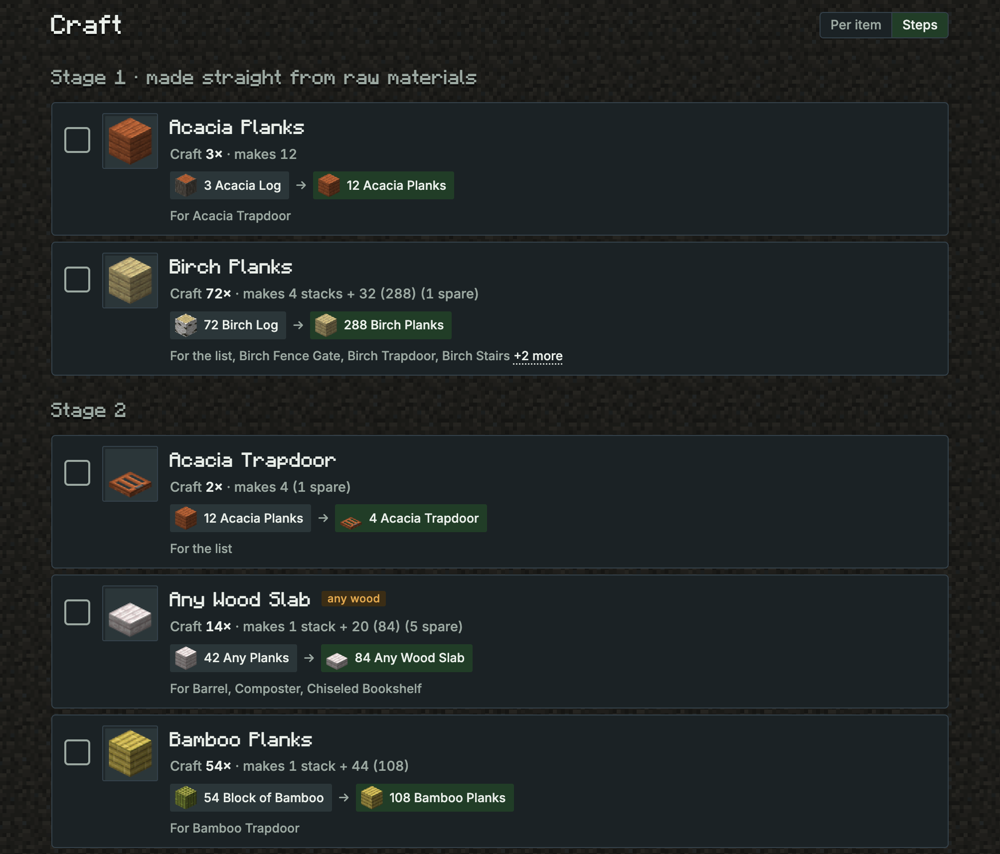

<p align="center">  </p> <p align="center"> <a href="https://www.minecraft.net"></a>  <a href="LICENSE"></a> <a href="https://claude.com"></a> </p> <p align="center"> <a href="#run-it">Run it</a> &middot; <a href="#use">Use</a> &middot; <a href="#what-it-does">Features</a> &middot; <a href="#shortcuts">Shortcuts</a> &middot; <a href="#limits">Limits</a> &middot; <a href="#how-it-works">How it works</a> &middot; <a href="#credits">Credits</a> </p>

Stackwise keeps track of the materials for your Minecraft builds. Make a list (or import one from Litematica), see every amount in stacks, tick off what you have, and let the Raw materials tab work out what is left to gather and craft.

<p align="center"> <br> <sub>The material list, with amounts in stacks and a progress bar per item.</sub> </p>

## Run it

1. Download or clone the repository.
2. Serve the folder with any static server, for example `python -m http.server`, and open `http://localhost:8000`.
3. Or publish it on GitHub Pages or any static host.

Progress is saved in your browser (`localStorage`), so use the same browser and address to keep it.

## Use

- **New project** starts an empty list. Search for a block, type an amount and tap **Add**.
- **Import a Litematica list** from New project or Options. Paste the `.txt` material table, or a plain list like `64 Oak Planks`.
- Importing a list with the title of an existing project updates it and keeps your progress.
- Type amounts as a number, or in stacks: `2s+10` means 2 stacks + 10.
- Type what you already have in **Have**, or use `+1` and `+stack`. Clearing the field sets it to 0.
- Tick an item to mark it as done. Untick it and the amount you had before comes back.

<p align="center"> <br> <sub>Importing a Litematica material list.</sub> </p>

## What it does

**Amounts in stacks.** Quantities show as `9 stacks + 43 (619)`, with the right stack size for each item (64, 16 or 1).

**Filter, search and sort.** Show all, only what is left to do, or only what is done. Search by name, and sort by list order, A to Z or most needed (the biggest amounts first). **Edit list** lets you change the amounts or remove items.

**Raw materials.** This tab looks at everything you still have to build and works out what it takes, using the recipes of Minecraft Java 1.21.11. It has two parts:

- **Gather** is the list of raw materials you still need to collect, with a progress bar. Open **Used for** on any item to see what it goes into. **Copy list** puts the remaining materials on your clipboard.
- **Craft** shows what to craft, either **Per item** as a tree, or as **Steps** grouped in stages, from things made straight from raw materials up to the final items. Smelting and stripping steps are marked.

<p align="center">  <br> <sub>The Craft tab with both the Per item view and the Steps view.</sub> </p>

**Crafting updates your list.** Tick a crafting step and its result is added to your Material list, and the ingredients are taken from what you have. Ticked steps go to a **Crafted** log, where you can undo any of them.

**Any wood.** Materials that accept any wood (planks, logs, wood slabs) are marked **any wood**.

**Several projects.** Switch between projects from the menu at the top. Rename, reset or delete them in **Options**. Deleting asks for confirmation first.

**Backup.** Options has a backup text with all your projects. Copy it somewhere safe and paste it into Import a list to restore everything, even in another browser.

## Shortcuts

|Action|Use|
|---|---|
|`Enter` in the item field|Pick the highlighted suggestion|
|`Up` and `Down` in the item field|Move through the suggestions|
|`Enter` in the amount field|Add the item|
|`Up` and `Down` in a Have field|Add or remove 1|
|`Shift` + `Up` or `Down` in a Have field|Add or remove one stack|
|`Esc`|Close a dialog|

## Limits

- Recipes and items are for Minecraft Java 1.21.11 only.
- Items from an import that Stackwise does not know are kept with a `?` icon and the default stack size of 64.
- Progress lives in one browser. Tabs of the same browser stay in sync. Use the backup to move it to another browser.
- If the browser cannot save (private mode or full storage), Stackwise shows a warning so you can copy a backup.
- Stackwise follows the `prefers-reduced-motion` setting of your system and turns animations off when it is set.

## How it works

Plain HTML, CSS and JavaScript, with no build and no dependencies.

```
index.html
style.css
app.js          events, actions and the render loop
js/
  state.js      data, helpers, saved state, import parsing
  planner.js    the raw materials and crafting planner
  views.js      the HTML for lists, trees, steps and dialogs
  fx.js         animations
data/
  items.js      item names and stack sizes
  recipes.js    recipes
  sample.js     the example list
icons/          one PNG per item, named with the Minecraft id
fonts/          Minecraft font
img/            logo and background
docs/           banner and screenshots for this README
```

The scripts are plain files loaded in order from `index.html`, and they share one `SW` object, so there are no modules and it also works when opened straight from disk. Everything lives in one state object that is saved to `localStorage`. The planner (`js/planner.js`) walks the recipes from your items down to raw materials, subtracts what you already have, and counts the crafts needed at each step.

## License

Stackwise is released under the [MIT License](LICENSE). The license covers the Stackwise code only. Minecraft textures, item icons and the Minecraft font are not part of it (see Credits).

## Credits

Stackwise is not affiliated with Mojang or Microsoft. Minecraft textures and the Minecraft font belong to Mojang Studios.

Item icons by [MC Item Gallery](https://mcitemgallery.com/).